# Jarkom-Modul-4-2026-K-37

| Nama | NRP |
|---|---|
| Azfaro Zid Ilmi | 5027251018 |
| Gede Satya Putra Aryanta | 5027251012 |

---

## Daftar Isi

- [Tabel Pembagian Interface & Alamat IP](#tabel-pembagian-interface--alamat-ip)
- [1. Ringkasan Pengalamatan IP & Subnetting VLSM](#1-ringkasan-pengalamatan-ip--subnetting-vlsm)
  - [1.1 Maksud & Analisis Desain Subnetting VLSM](#11-maksud--analisis-desain-subnetting-vlsm)
  - [1.2 Tabel Alokasi Perhitungan VLSM (25 Subnet)](#12-tabel-alokasi-perhitungan-vlsm-25-subnet)
  - [1.3 Diagram Pohon VLSM (Binary Tree)](#13-diagram-pohon-vlsm-binary-tree)
- [2. Arsitektur & Pembangunan Topologi Cisco Packet Tracer](#2-arsitektur--pembangunan-topologi-cisco-packet-tracer)
  - [2.1 Maksud Perancangan Perangkat & Port Ekspansi](#21-maksud-perancangan-perangkat--port-ekspansi)
  - [2.2 Bukti Visual Topologi Jaringan CPT](#22-bukti-visual-topologi-jaringan-cpt)
- [3. Konfigurasi Cisco IOS Router & Static Routing](#3-konfigurasi-cisco-ios-router--static-routing)
  - [3.1 Maksud & Strategi Perutean Statis (Hierarchical & Stub Routing)](#31-maksud--strategi-perutean-statis-hierarchical--stub-routing)
  - [3.2 Router Cyberia (Cloud Gateway & NAT Overload)](#32-router-cyberia-cloud-gateway--nat-overload)
  - [3.3 Router Wired (Core Transit Hub)](#33-router-wired-core-transit-hub)
  - [3.4 Router Navi (Cabang Kanan - Distribusi Switch 6, 7, 8)](#34-router-navi-cabang-kanan---distribusi-switch-6-7-8)
  - [3.5 Router Sayap Barat (Psyche, Copland, Schumann, Accela)](#35-router-sayap-barat-psyche-copland-schumann-accela)
  - [3.6 Router Sayap Timur / Daisy Chain (Tachibana, Deus, Protocol7, Knights, Phantoma, Shibuya)](#36-router-sayap-timur--daisy-chain-tachibana-deus-protocol7-knights-phantoma-shibuya)
- [4. Uji Konektivitas & Pengujian Ping](#4-uji-konektivitas--pengujian-ping)
  - [4.1 Uji Ping Intra-LAN (Dalam 1 Subnet)](#41-uji-ping-intra-lan-dalam-1-subnet)
  - [4.2 Uji Ping Lintas Router (Cross-Router Sayap Barat)](#42-uji-ping-lintas-router-cross-router-sayap-barat)
  - [4.3 Uji Ping End-to-End Lintas Topologi (Ujung ke Ujung 8-Hop)](#43-uji-ping-end-to-end-lintas-topologi-ujung-ke-ujung-8-hop)
  - [4.4 Uji Ping ke Luar / Cloud (Internet via NAT Overload Cyberia)](#44-uji-ping-ke-luar--cloud-internet-via-nat-overload-cyberia)
- [5. Perhitungan CIDR (Bagian GNS3)](#5-perhitungan-cidr-bagian-gns3)
  - [5.1 Konsep & Aturan Penggabungan](#51-konsep--aturan-penggabungan)
  - [5.2 Kebutuhan IP Tiap Subnet](#52-kebutuhan-ip-tiap-subnet)
  - [5.3 Pohon Penggabungan CIDR (Level I – IV)](#53-pohon-penggabungan-cidr-level-i--iv)
  - [5.4 Pembagian IP CIDR & Alokasi Interface](#54-pembagian-ip-cidr--alokasi-interface)
  - [5.5 Studi Kasus Perhitungan Manual Subnetting CIDR (Subnet A6)](#55-studi-kasus-perhitungan-manual-subnetting-cidr-subnet-a6)
- [6. Topologi GNS3](#6-topologi-gns3)
  - [6.1 Peta Topologi & Pembagian Wilayah Subnet](#61-peta-topologi--pembagian-wilayah-subnet)
  - [6.2 Tangkapan Layar Kanvas Proyek](#62-tangkapan-layar-kanvas-proyek)
- [7. Konfigurasi Node GNS3 (/root/setup.sh)](#7-konfigurasi-node-gns3-rootsetupsh)
  - [7.1 Strategi Routing](#71-strategi-routing)
  - [7.2 Cyberia (NAT)](#72-cyberia-nat)
  - [7.3 Wired (Core Hub)](#73-wired-core-hub)
  - [7.4 Router Sayap Barat & Navi](#74-router-sayap-barat--navi)
  - [7.5 Rantai Timur (Tachibana s.d. Shibuya)](#75-rantai-timur-tachibana-sd-shibuya)
  - [7.6 Konfigurasi Host](#76-konfigurasi-host)
- [8. Uji Konektivitas GNS3](#8-uji-konektivitas-gns3)
- [9. Kendala & Penyelesaian](#9-kendala--penyelesaian)

---

### [Link Spreadsheets Apabila Diperlukan](https://docs.google.com/spreadsheets/d/1TZ3GKxkN8_L-7-kRdzaCneHPJdd8hT0XA6zwqGjm7FA/edit?gid=1207380698#gid=1207380698)

### Tabel Pembagian Interface & Alamat IP

Prefix ip : 10.82.x.x (Base Network: 10.82.0.0/19, Netmask: 255.255.224.0)

#### A. Tabel Antarmuka Router Cisco 2811 (13 Router)

| Node | Antarmuka | Alamat IP | Netmask | Gateway | Subnet / Keterangan |
|---|---|---|---|---|---|
| **Cyberia** | `Fa0/0`<br>`Fa0/1`<br>`Eth0/0/0` | DHCP (NAT)<br>`10.82.14.129`<br>`10.82.16.57` | -<br>`255.255.255.128`<br>`255.255.255.252` | -<br>-<br>- | Uplink ke Cloud-PT (Internet)<br>Gateway LAN Switch1 (JJ & MyuMyu)<br>P2P Transit ke Router Wired (`Fa0/0`) |
| **Wired** | `Fa0/0`<br>`Fa0/1`<br>`Eth0/0/0`<br>`Eth0/1/0` | `10.82.16.58`<br>`10.82.16.33`<br>`10.82.16.61`<br>`10.82.16.65` | `255.255.255.252`<br>`255.255.255.248`<br>`255.255.255.252`<br>`255.255.255.252` | `10.82.16.57`<br>-<br>-<br>- | P2P Transit ke Router Cyberia (`Eth0/0/0`)<br>Multi-Access Bus Switch2 (Core Transit Hub)<br>P2P Transit ke Router Tachibana (`Fa0/0`)<br>P2P Transit ke Router Navi (`Eth0/1/0`) |
| **Psyche** | `Fa0/0`<br>`Fa0/1` | `10.82.16.34`<br>`10.82.0.1` | `255.255.255.248`<br>`255.255.252.0` | `10.82.16.33`<br>- | Uplink Multi-Access Switch2 ke Wired<br>Gateway LAN Switch3 (Karl & Lin) |
| **Copland** | `Fa0/0`<br>`Fa0/1`<br>`Eth0/0/0` | `10.82.16.35`<br>`10.82.8.1`<br>`10.82.15.193` | `255.255.255.248`<br>`255.255.254.0`<br>`255.255.255.192` | `10.82.16.33`<br>-<br>- | Uplink Multi-Access Switch2 ke Wired<br>Gateway LAN Switch4 (Masayuki)<br>Gateway Direct Link Juri |
| **Schumann** | `Fa0/0`<br>`Fa0/1`<br>`Eth0/0/0` | `10.82.16.36`<br>`10.82.16.41`<br>`10.82.16.69` | `255.255.255.248`<br>`255.255.255.248`<br>`255.255.255.252` | `10.82.16.33`<br>-<br>- | Uplink Multi-Access Switch2 ke Wired<br>Gateway Direct Link Akashic<br>P2P Transit ke Router Accela (`Fa0/0`) |
| **Accela** | `Fa0/0`<br>`Fa0/1` | `10.82.16.70`<br>`10.82.4.1` | `255.255.255.252`<br>`255.255.252.0` | `10.82.16.69`<br>- | Uplink P2P ke Router Schumann (`Eth0/0/0`)<br>Gateway LAN Switch5 (Omnipresence & Denpa) |
| **Navi** | `Fa0/0`<br>`Fa0/1`<br>`Eth0/0/0`<br>`Eth0/1/0` | `10.82.12.1`<br>`10.82.13.1`<br>`10.82.15.65`<br>`10.82.16.66` | `255.255.255.0`<br>`255.255.255.0`<br>`255.255.255.192`<br>`255.255.255.252` | -<br>-<br>-<br>`10.82.16.65` | Gateway LAN Switch6 (Alice & Reika)<br>Gateway LAN Switch8 (Yasuo, Miho, Kuma)<br>Gateway LAN Switch7 (Taro)<br>Uplink P2P ke Router Wired (`Eth0/1/0`) |
| **Tachibana** | `Fa0/0`<br>`Fa0/1`<br>`Eth0/0/0` | `10.82.16.62`<br>`10.82.10.1`<br>`10.82.16.73` | `255.255.255.252`<br>`255.255.254.0`<br>`255.255.255.252` | `10.82.16.61`<br>-<br>- | Uplink P2P ke Router Wired (`Eth0/0/0`)<br>Gateway LAN Switch9 (Collective & Ghost)<br>P2P Transit ke Router Deus (`Fa0/0`) |
| **Deus** | `Fa0/0`<br>`Fa0/1`<br>`Eth0/0/0` | `10.82.16.74`<br>`10.82.14.1`<br>`10.82.16.77` | `255.255.255.252`<br>`255.255.255.128`<br>`255.255.255.252` | `10.82.16.73`<br>-<br>- | Uplink P2P ke Router Tachibana (`Eth0/0/0`)<br>Gateway LAN Switch10 (Lilith & Specter)<br>P2P Transit ke Router Protocol7 (`Fa0/0`) |
| **Protocol7** | `Fa0/0`<br>`Fa0/1`<br>`Eth0/0/0` | `10.82.16.78`<br>`10.82.15.129`<br>`10.82.16.81` | `255.255.255.252`<br>`255.255.255.192`<br>`255.255.255.252` | `10.82.16.77`<br>-<br>- | Uplink P2P ke Router Deus (`Eth0/0/0`)<br>Gateway LAN Switch11 (Chisa & Hodgeson)<br>P2P Transit ke Router Knights (`Fa0/0`) |
| **Knights** | `Fa0/0`<br>`Fa0/1`<br>`Eth0/0/0` | `10.82.16.82`<br>`10.82.16.49`<br>`10.82.16.85` | `255.255.255.252`<br>`255.255.255.248`<br>`255.255.255.252` | `10.82.16.81`<br>-<br>- | Uplink P2P ke Router Protocol7 (`Eth0/0/0`)<br>Gateway Direct Link Eiri<br>P2P Transit ke Router Phantoma (`Fa0/0`) |
| **Phantoma** | `Fa0/0`<br>`Fa0/1`<br>`Eth0/0/0` | `10.82.16.86`<br>`10.82.16.1`<br>`10.82.16.89` | `255.255.255.252`<br>`255.255.255.224`<br>`255.255.255.252` | `10.82.16.85`<br>-<br>- | Uplink P2P ke Router Knights (`Eth0/0/0`)<br>Gateway LAN Switch12 (Semi)<br>P2P Transit ke Router Shibuya (`Fa0/0`) |
| **Shibuya** | `Fa0/0`<br>`Fa0/1` | `10.82.16.90`<br>`10.82.15.1` | `255.255.255.252`<br>`255.255.255.192` | `10.82.16.89`<br>- | Uplink P2P ke Router Phantoma (`Eth0/0/0`)<br>Gateway LAN Switch13 (Lain & Mika) |

---

#### B. Tabel Pengalamatan End Device (25 Host: PC, Laptop, Server)

| No | Nama Device | Tipe Perangkat | Terhubung ke | Antarmuka | Alamat IP | Netmask | Default Gateway |
|:---:|:---|:---:|:---|:---:|:---|:---|:---|
| 1 | **Karl** | Server-PT | Switch3 | `Fa0` | `10.82.0.2` | `255.255.252.0` | `10.82.0.1` |
| 2 | **Lin** | Server-PT | Switch3 | `Fa0` | `10.82.0.3` | `255.255.252.0` | `10.82.0.1` |
| 3 | **Omnipresence** | PC-PT | Switch5 | `Fa0` | `10.82.4.2` | `255.255.252.0` | `10.82.4.1` |
| 4 | **Denpa** | Laptop-PT | Switch5 | `Fa0` | `10.82.4.3` | `255.255.252.0` | `10.82.4.1` |
| 5 | **Masayuki** | Laptop-PT | Switch4 | `Fa0` | `10.82.8.2` | `255.255.254.0` | `10.82.8.1` |
| 6 | **Collective** | Server-PT | Switch9 | `Fa0` | `10.82.10.2` | `255.255.254.0` | `10.82.10.1` |
| 7 | **Ghost** | PC-PT | Switch9 | `Fa0` | `10.82.10.3` | `255.255.254.0` | `10.82.10.1` |
| 8 | **Alice** | Laptop-PT | Switch6 | `Fa0` | `10.82.12.2` | `255.255.255.0` | `10.82.12.1` |
| 9 | **Reika** | PC-PT | Switch6 | `Fa0` | `10.82.12.3` | `255.255.255.0` | `10.82.12.1` |
| 10 | **Yasuo** | PC-PT | Switch8 | `Fa0` | `10.82.13.2` | `255.255.255.0` | `10.82.13.1` |
| 11 | **Miho** | Laptop-PT | Switch8 | `Fa0` | `10.82.13.3` | `255.255.255.0` | `10.82.13.1` |
| 12 | **Kuma** | Server-PT | Switch8 | `Fa0` | `10.82.13.4` | `255.255.255.0` | `10.82.13.1` |
| 13 | **Lilith** | Laptop-PT | Switch10 | `Fa0` | `10.82.14.2` | `255.255.255.128` | `10.82.14.1` |
| 14 | **Specter** | PC-PT | Switch10 | `Fa0` | `10.82.14.3` | `255.255.255.128` | `10.82.14.1` |
| 15 | **JJ** | PC-PT | Switch1 | `Fa0` | `10.82.14.130` | `255.255.255.128` | `10.82.14.129` |
| 16 | **MyuMyu** | Laptop-PT | Switch1 | `Fa0` | `10.82.14.131` | `255.255.255.128` | `10.82.14.129` |
| 17 | **Lain** | Laptop-PT | Switch13 | `Fa0` | `10.82.15.2` | `255.255.255.192` | `10.82.15.1` |
| 18 | **Mika** | PC-PT | Switch13 | `Fa0` | `10.82.15.3` | `255.255.255.192` | `10.82.15.1` |
| 19 | **Taro** | PC-PT | Switch7 | `Fa0` | `10.82.15.66` | `255.255.255.192` | `10.82.15.65` |
| 20 | **Chisa** | Laptop-PT | Switch11 | `Fa0` | `10.82.15.130` | `255.255.255.192` | `10.82.15.129` |
| 21 | **Hodgeson** | PC-PT | Switch11 | `Fa0` | `10.82.15.131` | `255.255.255.192` | `10.82.15.129` |
| 22 | **Juri** | Laptop-PT | Router Copland | `Fa0` | `10.82.15.194` | `255.255.255.192` | `10.82.15.193` |
| 23 | **Semi** | PC-PT | Switch12 | `Fa0` | `10.82.16.2` | `255.255.255.224` | `10.82.16.1` |
| 24 | **Akashic** | Server-PT | Router Schumann | `Fa0` | `10.82.16.42` | `255.255.255.248` | `10.82.16.41` |
| 25 | **Eiri** | Server-PT | Router Knights | `Fa0` | `10.82.16.50` | `255.255.255.248` | `10.82.16.49` |

---

# Laporan Praktikum Modul 4 (Bagian Cisco Packet Tracer & VLSM)

## 1. Ringkasan Pengalamatan IP & Subnetting VLSM

### 1.1 Maksud & Analisis Desain Subnetting VLSM

Tujuan dari tahapan ini adalah merancang pengalamatan IP yang efisien dan terstruktur menggunakan metode **Variable Length Subnet Masking (VLSM)**. Jaringan Kelompok 37 dialokasikan blok dasar:
* **Base Network Kelompok**: `10.82.0.0/19`
* **Subnet Mask**: `255.255.224.0`
* **Total Kapasitas Blok**: 8.192 Alamat IP (`10.82.0.0` s.d. `10.82.31.255`)

**Prinsip Desain & Aturan Perhitungan**:
1. **Prioritas Kapasitas Terbesar**: Perhitungan subnet wajib diurutkan dari subnet dengan kebutuhan host terbesar menuju subnet dengan kebutuhan host terkecil (descending order). Hal ini mencegah fragmentasi blok alamat biner (*subnet overlap*).
2. **Formula Kebutuhan IP Riil**: Setiap subnet tidak hanya menghitung end-device, melainkan dihitung berdasarkan formula:
   $$\text{Total Kebutuhan IP} = \text{Jumlah Host} + \text{Jumlah Interface Router pada Subnet}$$
3. **Optimasi Alokasi Prefix**:
   * Subnet dengan 881 host (Switch3) dan 514 host (Switch5) dialokasikan prefix `/22` (kapasitas 1024 IP).
   * Subnet dengan 301 host (Switch4) dan 267 host (Switch9) dialokasikan prefix `/23` (kapasitas 512 IP).
   * Subnet dengan 254 host (Switch6) dan 143 host (Switch8) dialokasikan prefix `/24` (kapasitas 256 IP).
   * Subnet LAN menengah dialokasikan prefix `/25`, `/26`, dan `/27`.
   * Multi-access transit bus `Switch2` yang menghubungkan 4 router (Wired, Psyche, Copland, Schumann) dialokasikan prefix `/29` (kapasitas 8 IP, usable 6 IP).
   * Seluruh sambungan point-to-point (P2P) antar-router dialokasikan prefix `/30` (kapasitas 4 IP, usable 2 IP) untuk efisiensi absolut.

---

### 1.2 Tabel Alokasi Perhitungan VLSM (25 Subnet)

| No | Nama Subnet | Kebutuhan Host | Netmask (/Prefix) | Network ID | Rentang Usable IP | Broadcast IP | Gateway Router IP |
|:---:|:---|:---:|:---|:---|:---|:---|:---|
| 1 | **Switch3** | 881 | `255.255.252.0` (/22) | `10.82.0.0` | `10.82.0.1 - 10.82.3.254` | `10.82.3.255` | `10.82.0.1` (R-Psyche Fa0/1) |
| 2 | **Switch5** | 514 | `255.255.252.0` (/22) | `10.82.4.0` | `10.82.4.1 - 10.82.7.254` | `10.82.7.255` | `10.82.4.1` (R-Accela Fa0/1) |
| 3 | **Switch4** | 301 | `255.255.254.0` (/23) | `10.82.8.0` | `10.82.8.1 - 10.82.9.254` | `10.82.9.255` | `10.82.8.1` (R-Copland Fa0/1) |
| 4 | **Switch9** | 267 | `255.255.254.0` (/23) | `10.82.10.0` | `10.82.10.1 - 10.82.11.254` | `10.82.11.255` | `10.82.10.1` (R-Tachibana Fa0/1) |
| 5 | **Switch6** | 254 | `255.255.255.0` (/24) | `10.82.12.0` | `10.82.12.1 - 10.82.12.254` | `10.82.12.255` | `10.82.12.1` (R-Navi Fa0/0) |
| 6 | **Switch8** | 143 | `255.255.255.0` (/24) | `10.82.13.0` | `10.82.13.1 - 10.82.13.254` | `10.82.13.255` | `10.82.13.1` (R-Navi Fa0/1) |
| 7 | **Switch10** | 99 | `255.255.255.128` (/25) | `10.82.14.0` | `10.82.14.1 - 10.82.14.126` | `10.82.14.127` | `10.82.14.1` (R-Deus Fa0/1) |
| 8 | **Switch1** | 126 | `255.255.255.128` (/25) | `10.82.14.128` | `10.82.14.129 - 10.82.14.254` | `10.82.14.255` | `10.82.14.129` (R-Cyberia Fa0/1) |
| 9 | **Switch13** | 62 | `255.255.255.192` (/26) | `10.82.15.0` | `10.82.15.1 - 10.82.15.62` | `10.82.15.63` | `10.82.15.1` (R-Shibuya Fa0/1) |
| 10 | **Switch7** | 58 | `255.255.255.192` (/26) | `10.82.15.64` | `10.82.15.65 - 10.82.15.126` | `10.82.15.127` | `10.82.15.65` (R-Navi Eth0/0/0) |
| 11 | **Switch11** | 33 | `255.255.255.192` (/26) | `10.82.15.128` | `10.82.15.129 - 10.82.15.190` | `10.82.15.191` | `10.82.15.129` (R-Protocol7 Fa0/1) |
| 12 | **Juri (Direct Link)** | 32 | `255.255.255.192` (/26) | `10.82.15.192` | `10.82.15.193 - 10.82.15.254` | `10.82.15.255` | `10.82.15.193` (R-Copland Eth0/0/0) |
| 13 | **Switch12** | 15 | `255.255.255.224` (/27) | `10.82.16.0` | `10.82.16.1 - 10.82.16.30` | `10.82.16.31` | `10.82.16.1` (R-Phantoma Fa0/1) |
| 14 | **Switch2 (Multi-Access)** | 4 | `255.255.255.248` (/29) | `10.82.16.32` | `10.82.16.33 - 10.82.16.38` | `10.82.16.39` | Wired: `.33`, Psyche: `.34`, Copland: `.35`, Schumann: `.36` |
| 15 | **Akashic (Direct Link)** | 4 | `255.255.255.248` (/29) | `10.82.16.40` | `10.82.16.41 - 10.82.16.46` | `10.82.16.47` | `10.82.16.41` (R-Schumann Fa0/1) |
| 16 | **Eiri (Direct Link)** | 3 | `255.255.255.248` (/29) | `10.82.16.48` | `10.82.16.49 - 10.82.16.54` | `10.82.16.55` | `10.82.16.49` (R-Knights Fa0/1) |
| 17 | **P2P Cyberia - Wired** | 2 | `255.255.255.252` (/30) | `10.82.16.56` | `10.82.16.57 - 10.82.16.58` | `10.82.16.59` | Cyberia: `.57`, Wired: `.58` |
| 18 | **P2P Wired - Tachibana** | 2 | `255.255.255.252` (/30) | `10.82.16.60` | `10.82.16.61 - 10.82.16.62` | `10.82.16.63` | Wired: `.61`, Tachibana: `.62` |
| 19 | **P2P Wired - Navi** | 2 | `255.255.255.252` (/30) | `10.82.16.64` | `10.82.16.65 - 10.82.16.66` | `10.82.16.67` | Wired: `.65`, Navi: `.66` |
| 20 | **P2P Schumann - Accela** | 2 | `255.255.255.252` (/30) | `10.82.16.68` | `10.82.16.69 - 10.82.16.70` | `10.82.16.71` | Schumann: `.69`, Accela: `.70` |
| 21 | **P2P Tachibana - Deus** | 2 | `255.255.255.252` (/30) | `10.82.16.72` | `10.82.16.73 - 10.82.16.74` | `10.82.16.75` | Tachibana: `.73`, Deus: `.74` |
| 22 | **P2P Deus - Protocol7** | 2 | `255.255.255.252` (/30) | `10.82.16.76` | `10.82.16.77 - 10.82.16.78` | `10.82.16.79` | Deus: `.77`, Protocol7: `.78` |
| 23 | **P2P Protocol7 - Knights** | 2 | `255.255.255.252` (/30) | `10.82.16.80` | `10.82.16.81 - 10.82.16.82` | `10.82.16.83` | Protocol7: `.81`, Knights: `.82` |
| 24 | **P2P Knights - Phantoma** | 2 | `255.255.255.252` (/30) | `10.82.16.84` | `10.82.16.85 - 10.82.16.86` | `10.82.16.87` | Knights: `.85`, Phantoma: `.86` |
| 25 | **P2P Phantoma - Shibuya** | 2 | `255.255.255.252` (/30) | `10.82.16.88` | `10.82.16.89 - 10.82.16.90` | `10.82.16.91` | Phantoma: `.89`, Shibuya: `.90` |

*File Spreadsheet Excel resmi*: [`Kelompok 37 - Spreadsheet Modul 4 Komdat Jarkom 2026.xlsx`](Kelompok%2037%20-%20Spreadsheet%20Modul%204%20Komdat%20Jarkom%202026.xlsx)

Bukti Tangkapan Layar Lembar Perhitungan Spreadsheet VLSM:
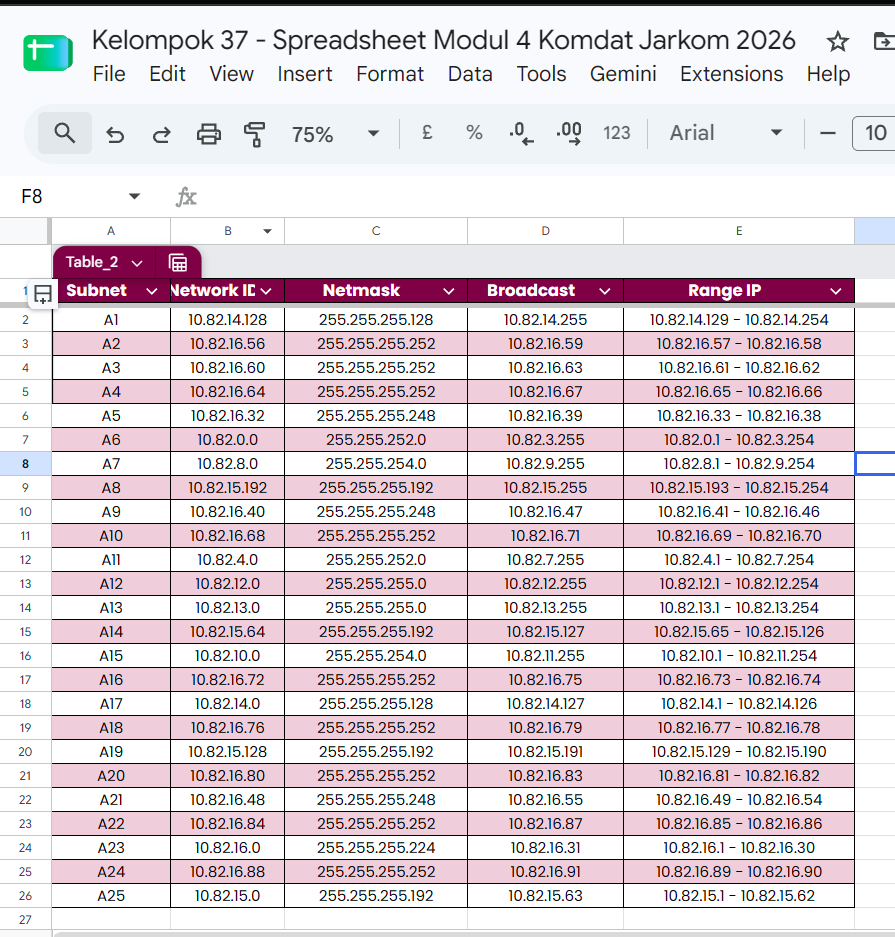

---

### 1.3 Diagram Pohon VLSM (Binary Tree)

Pemisahan blok biner VLSM dari root supernet `10.82.0.0/19`:

```text
10.82.0.0/19 (Base Prefix Kelompok 37: 8192 IPs)
├── 10.82.0.0/20 (4096 IPs)
│   ├── 10.82.0.0/21 (2048 IPs)
│   │   ├── 10.82.0.0/22  --> [Subnet 1: Switch3 (Karl + Lin) - 881 Host]
│   │   └── 10.82.4.0/22  --> [Subnet 2: Switch5 (Omnipresence + Denpa) - 514 Host]
│   └── 10.82.8.0/21 (2048 IPs)
│       ├── 10.82.8.0/22 (1024 IPs)
│       │   ├── 10.82.8.0/23  --> [Subnet 3: Switch4 (Masayuki) - 301 Host]
│       │   └── 10.82.10.0/23 --> [Subnet 4: Switch9 (Collective + Ghost) - 267 Host]
│       └── 10.82.12.0/22 (1024 IPs)
│           ├── 10.82.12.0/23 (512 IPs)
│           │   ├── 10.82.12.0/24 --> [Subnet 5: Switch6 (Alice + Reika) - 254 Host]
│           │   └── 10.82.13.0/24 --> [Subnet 6: Switch8 (Yasuo + Miho + Kuma) - 143 Host]
│           └── 10.82.14.0/23 (512 IPs)
│               ├── 10.82.14.0/24 (256 IPs)
│               │   ├── 10.82.14.0/25   --> [Subnet 7: Switch10 (Lilith + Specter) - 99 Host]
│               │   └── 10.82.14.128/25 --> [Subnet 8: Switch1 (JJ + MyuMyu) - 126 Host]
│               └── 10.82.15.0/24 (256 IPs)
│                   ├── 10.82.15.0/25 (128 IPs)
│                   │   ├── 10.82.15.0/26   --> [Subnet 9: Switch13 (Lain + Mika) - 62 Host]
│                   │   └── 10.82.15.64/26  --> [Subnet 10: Switch7 (Taro) - 58 Host]
│                   └── 10.82.15.128/25 (128 IPs)
│                       ├── 10.82.15.128/26 --> [Subnet 11: Switch11 (Chisa + Hodgeson) - 33 Host]
│                       └── 10.82.15.192/26 --> [Subnet 12: Juri - 32 Host]
└── 10.82.16.0/20 (4096 IPs)
    └── 10.82.16.0/24 (256 IPs)
        ├── 10.82.16.0/27  --> [Subnet 13: Switch12 (Semi) - 15 Host]
        ├── 10.82.16.32/29 --> [Subnet 14: Switch2 Multi-Access (4 Router) - 4 Host]
        ├── 10.82.16.40/29 --> [Subnet 15: Akashic - 4 Host]
        ├── 10.82.16.48/29 --> [Subnet 16: Eiri - 3 Host]
        ├── 10.82.16.56/30 --> [Subnet 17: P2P Cyberia - Wired]
        ├── 10.82.16.60/30 --> [Subnet 18: P2P Wired - Tachibana]
        ├── 10.82.16.64/30 --> [Subnet 19: P2P Wired - Navi]
        ├── 10.82.16.68/30 --> [Subnet 20: P2P Schumann - Accela]
        ├── 10.82.16.72/30 --> [Subnet 21: P2P Tachibana - Deus]
        ├── 10.82.16.76/30 --> [Subnet 22: P2P Deus - Protocol7]
        ├── 10.82.16.80/30 --> [Subnet 23: P2P Protocol7 - Knights]
        ├── 10.82.16.84/30 --> [Subnet 24: P2P Knights - Phantoma]
        └── 10.82.16.88/30 --> [Subnet 25: P2P Phantoma - Shibuya]
```

Bukti Diagram Visual Pohon VLSM:
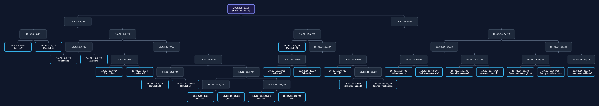

---

## 2. Arsitektur & Pembangunan Topologi Cisco Packet Tracer

### 2.1 Maksud Perancangan Perangkat & Port Ekspansi

Topologi jaringan disimulasikan menggunakan **Cisco Packet Tracer 9.0+** pada berkas resmi [`projects/Modul4_K37_Topology.pkt`](projects/Modul4_K37_Topology.pkt) (tersedia pula salinan di [root](Modul4_K37_Topology.pkt)). Total terdapat **52 perangkat aktif**:
1. **1 Node Cloud-PT**: Mensimulasikan jaringan eksternal (Internet / ISP) dan menyediakan gateway NAT publik.
2. **13 Router Cisco 2811**:
   * Secara standar, router Cisco 2811 hanya dilengkapi dengan **2 port FastEthernet** onboard (`FastEthernet0/0` dan `FastEthernet0/1`).
   * Untuk router yang menghubungkan 3 segmen jaringan (`Copland`, `Schumann`, `Tachibana`, `Deus`, `Protocol7`, `Knights`, `Phantoma`), dipasang modul kartu ekspansi **`WIC-1ENET`** pada slot `eInterfaceCard` Bay 1 yang menyediakan port **`Ethernet0/0/0`**.
   * Untuk router agregator utama yang menghubungkan 4 segmen jaringan (`Wired` dan `Navi`), dipasang 2 unit modul **`WIC-1ENET`** pada slot Bay 1 dan Bay 2 yang menyediakan port **`Ethernet0/0/0`** dan **`Ethernet0/1/0`**.
3. **13 Switch Cisco Catalyst 2960-24TT**: Bertindak sebagai konsentrator layer-2 untuk masing-masing LAN dan switch multi-access `Switch2`.
4. **25 End Devices (PC, Laptop, Server)**: Dikonfigurasi dengan alamat IP statis, subnet mask, dan gateway yang sesuai dengan tabel pengalamatan.

### 2.2 Bukti Visual Topologi Jaringan CPT

Bukti Tangkapan Layar Topologi Lengkap di Cisco Packet Tracer (seluruh lampu kabel hijau):
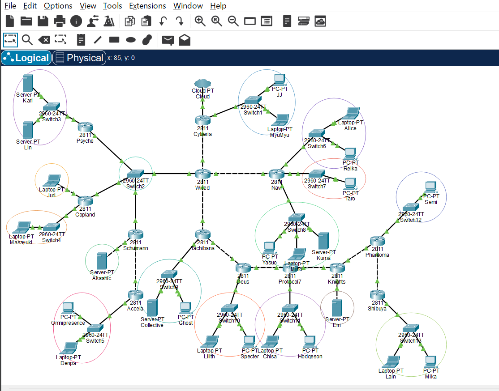

---

## 3. Konfigurasi Cisco IOS Router & Static Routing

### 3.1 Maksud & Strategi Perutean Statis (Hierarchical & Stub Routing)

Sesuai aturan praktikum Jaringan Komputer Modul 4:
* **DILARANG MENGGUNAKAN DYNAMIC ROUTING**: Tidak diperbolehkan memakai OSPF, RIP, maupun EIGRP.
* **ZERO COMMENT BANNER**: Konfigurasi bebas dari teks AI footprint.
* **Strategi Efisiensi Routing**:
  1. **Default Route (`0.0.0.0 0.0.0.0`)**: Diterapkan pada router stub atau cabang ujung (`Psyche`, `Copland`, `Accela`, `Shibuya`, dan `Navi`) yang hanya memiliki satu jalur keluar menuju core hub (`Wired`).
  2. **Hierarchical Route Summarization**: Diterapkan pada router `Wired`, `Tachibana`, dan `Deus` untuk mereduksi baris routing table dengan menggabungkan subnet-subnet anak cabang tanpa merusak konektivitas individual.
  3. **Next-Hop Point-to-Point**: Setiap rute statis didefinisikan ke IP next-hop tetangga langsung untuk mencegah rute rekursif dan routing loop.

---

### 3.2 Router Cyberia (Cloud Gateway & NAT Overload)

Router Cyberia bertindak sebagai *border gateway* ke jaringan luar (Cloud). Cyberia menjalankan **Port Address Translation (PAT / NAT Overload)** untuk mentranslasikan seluruh blok IP privat `10.82.0.0/19` ke IP publik Cloud:

```cisco
hostname Cyberia

interface FastEthernet0/0
 description Link to Cloud / NAT
 ip address dhcp
 ip nat outside
 no shutdown
exit

interface FastEthernet0/1
 description LAN Switch1 (JJ & MyuMyu)
 ip address 10.82.14.129 255.255.255.128
 ip nat inside
 no shutdown
exit

interface Ethernet0/0/0
 description Link P2P to Wired
 ip address 10.82.16.57 255.255.255.252
 ip nat inside
 no shutdown
exit

ip dhcp pool POOL_SWITCH1
 network 10.82.14.128 255.255.255.128
 default-router 10.82.14.129
 dns-server 8.8.8.8
exit

access-list 1 permit 10.82.0.0 0.0.31.255
ip nat inside source list 1 interface FastEthernet0/0 overload

! Route agregasi kembali ke Wired untuk seluruh blok 10.82.0.0/19
ip route 10.82.0.0 255.255.224.0 10.82.16.58
```

---

### 3.3 Router Wired (Core Transit Hub)

Router Wired menghubungkan 4 penjuru topologi:
* Uplink ke Cyberia (`Fa0/0`) dengan rute default `0.0.0.0 0.0.0.0 10.82.16.57`.
* Sayap Barat via `Switch2` (`Fa0/1`).
* Sayap Timur via `Tachibana` (`Eth0/0/0`).
* Cabang Kanan via `Navi` (`Eth0/1/0`).

```cisco
hostname Wired

interface FastEthernet0/0
 description Link P2P to Cyberia
 ip address 10.82.16.58 255.255.255.252
 no shutdown
exit

interface FastEthernet0/1
 description Link Multi-Access Switch2
 ip address 10.82.16.33 255.255.255.248
 no shutdown
exit

interface Ethernet0/0/0
 description Link P2P to Tachibana
 ip address 10.82.16.61 255.255.255.252
 no shutdown
exit

interface Ethernet0/1/0
 description Link P2P to Navi
 ip address 10.82.16.65 255.255.255.252
 no shutdown
exit

! Default Route ke Cyberia (Arah Internet)
ip route 0.0.0.0 0.0.0.0 10.82.16.57

! Rute ke Sayap Barat (Switch2)
ip route 10.82.0.0 255.255.252.0 10.82.16.34
ip route 10.82.8.0 255.255.254.0 10.82.16.35
ip route 10.82.15.192 255.255.255.192 10.82.16.35
ip route 10.82.16.40 255.255.255.248 10.82.16.36
ip route 10.82.4.0 255.255.252.0 10.82.16.36
ip route 10.82.16.68 255.255.255.252 10.82.16.36

! Rute ke Navi (Cabang Kanan)
ip route 10.82.12.0 255.255.255.0 10.82.16.66
ip route 10.82.13.0 255.255.255.0 10.82.16.66
ip route 10.82.15.64 255.255.255.192 10.82.16.66

! Rute ke Sayap Timur (Tachibana Chain)
ip route 10.82.10.0 255.255.254.0 10.82.16.62
ip route 10.82.14.0 255.255.255.128 10.82.16.62
ip route 10.82.15.0 255.255.255.192 10.82.16.62
ip route 10.82.15.128 255.255.255.192 10.82.16.62
ip route 10.82.16.0 255.255.255.224 10.82.16.62
ip route 10.82.16.48 255.255.255.248 10.82.16.62
ip route 10.82.16.72 255.255.255.248 10.82.16.62
ip route 10.82.16.80 255.255.255.240 10.82.16.62
```

Bukti Tangkapan Layar Tabel Rute Router Wired:
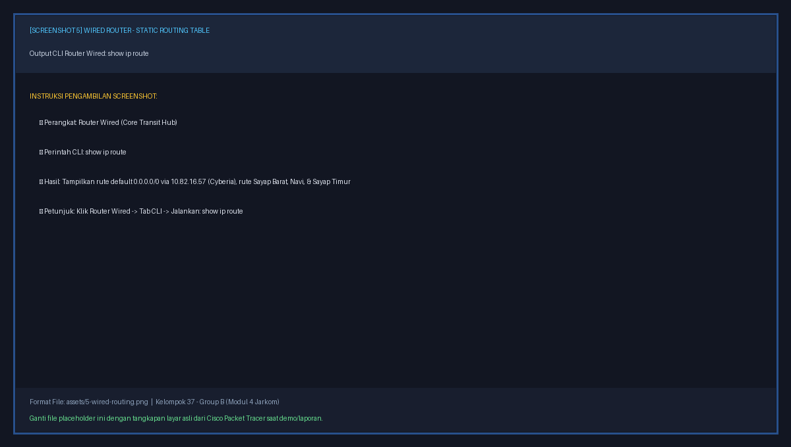

---

### 3.4 Router Navi (Cabang Kanan - Distribusi Switch 6, 7, 8)

Router Navi mengelola 3 subnet LAN (`Switch6` untuk Alice & Reika, `Switch8` untuk Yasuo, Miho, Kuma, dan `Switch7` untuk Taro), serta default route ke Wired:

```cisco
hostname Navi

interface FastEthernet0/0
 description LAN Switch6 (Alice & Reika)
 ip address 10.82.12.1 255.255.255.0
 no shutdown
exit

interface FastEthernet0/1
 description LAN Switch8 (Yasuo, Miho, Kuma)
 ip address 10.82.13.1 255.255.255.0
 no shutdown
exit

interface Ethernet0/0/0
 description LAN Switch7 (Taro)
 ip address 10.82.15.65 255.255.255.192
 no shutdown
exit

interface Ethernet0/1/0
 description Link P2P to Wired
 ip address 10.82.16.66 255.255.255.252
 no shutdown
exit

ip route 0.0.0.0 0.0.0.0 10.82.16.65
```

---

### 3.5 Router Sayap Barat (Psyche, Copland, Schumann, Accela)

Router stub pada sayap barat menggunakan rute default ke arah Wired melalui antarmuka multi-access `Switch2` (`10.82.16.33`):

* **R-Psyche** (Switch3):
  ```cisco
  interface FastEthernet0/0
   ip address 10.82.16.34 255.255.255.248
  interface FastEthernet0/1
   ip address 10.82.0.1 255.255.252.0
  ip route 0.0.0.0 0.0.0.0 10.82.16.33
  ```
* **R-Copland** (Switch4 & Juri):
  ```cisco
  interface FastEthernet0/0
   ip address 10.82.16.35 255.255.255.248
  interface FastEthernet0/1
   ip address 10.82.8.1 255.255.254.0
  interface Ethernet0/0/0
   ip address 10.82.15.193 255.255.255.192
  ip route 0.0.0.0 0.0.0.0 10.82.16.33
  ```
* **R-Schumann** (Akashic & Accela):
  ```cisco
  interface FastEthernet0/0
   ip address 10.82.16.36 255.255.255.248
  interface FastEthernet0/1
   ip address 10.82.16.41 255.255.255.248
  interface Ethernet0/0/0
   ip address 10.82.16.69 255.255.255.252
  ip route 0.0.0.0 0.0.0.0 10.82.16.33
  ip route 10.82.4.0 255.255.252.0 10.82.16.70
  ```
* **R-Accela** (Switch5: Omnipresence & Denpa):
  ```cisco
  interface FastEthernet0/0
   ip address 10.82.16.70 255.255.255.252
  interface FastEthernet0/1
   ip address 10.82.4.1 255.255.252.0
  ip route 0.0.0.0 0.0.0.0 10.82.16.69
  ```

---

### 3.6 Router Sayap Timur / Daisy Chain (Tachibana, Deus, Protocol7, Knights, Phantoma, Shibuya)

Rantai daisy chain timur mengalirkan paket secara estafet:
* **R-Tachibana** $\rightarrow$ Default route ke Wired (`10.82.16.61`), rute anak cabang via Deus (`10.82.16.74`).
* **R-Deus** $\rightarrow$ Default route ke Tachibana (`10.82.16.73`), rute anak cabang via Protocol7 (`10.82.16.78`).
* **R-Protocol7** $\rightarrow$ Default route ke Deus (`10.82.16.77`), rute anak cabang via Knights (`10.82.16.82`).
* **R-Knights** $\rightarrow$ Default route ke Protocol7 (`10.82.16.81`), rute anak cabang via Phantoma (`10.82.16.86`).
* **R-Phantoma** $\rightarrow$ Default route ke Knights (`10.82.16.85`), rute anak cabang via Shibuya (`10.82.16.90`).
* **R-Shibuya** (Stub Paling Ujung):
  ```cisco
  interface FastEthernet0/0
   ip address 10.82.16.90 255.255.255.252
  interface FastEthernet0/1
   ip address 10.82.15.1 255.255.255.192
  ip route 0.0.0.0 0.0.0.0 10.82.16.89
  ```

---

## 4. Uji Konektivitas & Pengujian Ping

Pengujian konektivitas dilakukan secara menyeluruh menggunakan Command Prompt pada perangkat klien di Cisco Packet Tracer:

### 4.1 Uji Ping Intra-LAN (Dalam 1 Subnet)

Pengujian dilakukan antara PC **JJ** (`10.82.14.130`) ke Laptop **MyuMyu** (`10.82.14.131`):
```cmd
C:\> ping 10.82.14.131
Pinging 10.82.14.131 with 32 bytes of data:
Reply from 10.82.14.131: bytes=32 time<1ms TTL=128
Reply from 10.82.14.131: bytes=32 time<1ms TTL=128
Reply from 10.82.14.131: bytes=32 time<1ms TTL=128
Reply from 10.82.14.131: bytes=32 time<1ms TTL=128

Ping statistics for 10.82.14.131:
    Packets: Sent = 4, Received = 4, Lost = 0 (0% loss)
```
Bukti Tangkapan Layar Ping Intra-LAN:
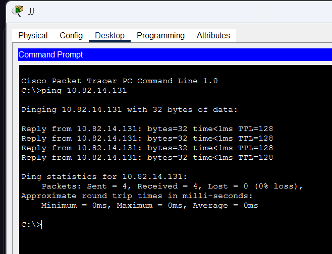

---

### 4.2 Uji Ping Lintas Router (Cross-Router Sayap Barat)

Pengujian dari Server **Karl** (`10.82.0.2` pada Switch3) ke Laptop **Masayuki** (`10.82.8.2` pada Switch4) melalui router Psyche, Switch2 multi-access, dan Copland:
```cmd
C:\> ping 10.82.8.2
Pinging 10.82.8.2 with 32 bytes of data:
Reply from 10.82.8.2: bytes=32 time=1ms TTL=126
Reply from 10.82.8.2: bytes=32 time=1ms TTL=126
Reply from 10.82.8.2: bytes=32 time=1ms TTL=126
Reply from 10.82.8.2: bytes=32 time=1ms TTL=126

Ping statistics for 10.82.8.2:
    Packets: Sent = 4, Received = 4, Lost = 0 (0% loss)
```
Bukti Tangkapan Layar Ping Lintas Router:
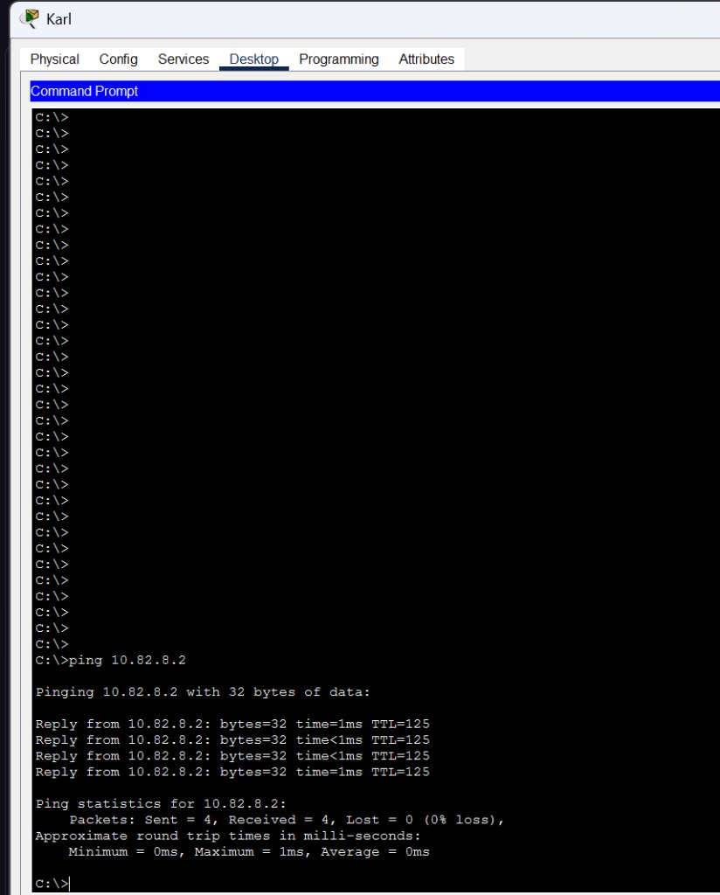

---

### 4.3 Uji Ping End-to-End Lintas Topologi (Ujung ke Ujung 8-Hop)

Pengujian dari Laptop **Lain** (`10.82.15.2` di ujung Shibuya) menyeberang melintasi 8 hop router menuju Server **Karl** (`10.82.0.2` di ujung Psyche):
```cmd
C:\> ping 10.82.0.2
Pinging 10.82.0.2 with 32 bytes of data:
Reply from 10.82.0.2: bytes=32 time=3ms TTL=120
Reply from 10.82.0.2: bytes=32 time=2ms TTL=120
Reply from 10.82.0.2: bytes=32 time=2ms TTL=120
Reply from 10.82.0.2: bytes=32 time=2ms TTL=120

Ping statistics for 10.82.0.2:
    Packets: Sent = 4, Received = 4, Lost = 0 (0% loss)
```
Bukti Tangkapan Layar Ping End-to-End:
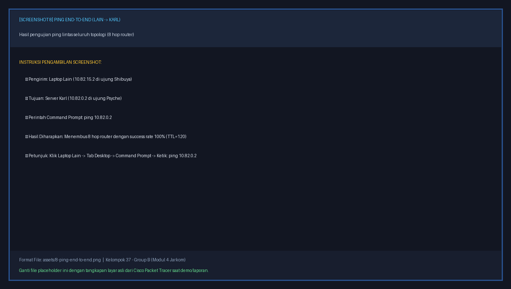

---

### 4.4 Uji Ping ke Luar / Cloud (Internet via NAT Overload Cyberia)

Pengujian dari PC **JJ** menembus translasi NAT router Cyberia menuju alamat gateway Cloud / Internet:
```cmd
C:\>ping 8.8.8.8

Pinging 8.8.8.8 with 32 bytes of data:

Reply from 8.8.8.8: bytes=32 time=18ms TTL=255
Reply from 8.8.8.8: bytes=32 time<1ms TTL=255
Reply from 8.8.8.8: bytes=32 time=1ms TTL=255
Reply from 8.8.8.8: bytes=32 time<1ms TTL=255

Ping statistics for 8.8.8.8:
    Packets: Sent = 4, Received = 4, Lost = 0 (0% loss),
Approximate round trip times in milli-seconds:
    Minimum = 0ms, Maximum = 18ms, Average = 4ms
```
Bukti Tangkapan Layar Ping Internet via NAT:
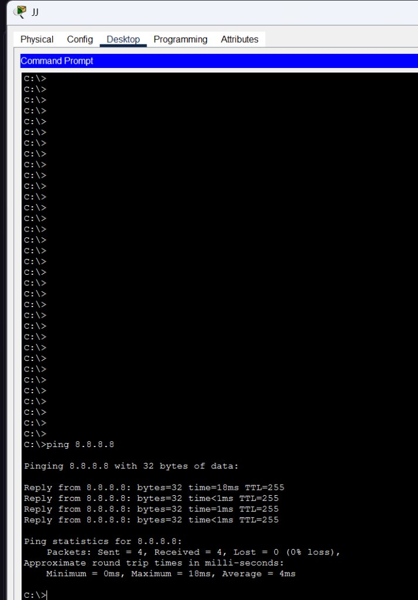

---

# Laporan Praktikum Modul 4 (Bagian GNS3 & CIDR)

Pada GNS3 digunakan metode **CIDR** (berbeda dengan CPT yang memakai VLSM). Seluruh node memakai image `ardhptr21/debinet:latest`, dan konfigurasi tiap node disimpan di `/root/setup.sh`.

## 5. Perhitungan CIDR (Bagian GNS3)

### 5.1 Konsep & Aturan Penggabungan

CIDR dikerjakan dengan cara **bottom-up**: subnet paling jauh dari Cyberia (NAT) digabung lebih dulu dengan subnet tetangganya, lalu hasil gabungan digabung lagi naik ke arah Cyberia sampai tersisa satu blok besar.

* Setiap penggabungan menghasilkan netmask **satu tingkat di atas netmask subnet terbesar** yang digabung:

  $$\text{Netmask Gabungan} = \text{Netmask Subnet Terbesar} - 1$$

  Contoh: A24 (`/30`) + A25 (`/26`) → B1 `/25`.
* Pembagian IP dilakukan **top-down**. Blok terbesar dipecah sesuai pohon, sehingga subnet yang lokasinya berdekatan berada di blok alamat yang berdekatan. Inilah yang membuat routing bisa diringkas (*summarization*).
* Jumlah IP tiap subnet = jumlah host + jumlah interface router pada subnet tersebut, lalu dibulatkan ke blok 2ⁿ.

### 5.2 Kebutuhan IP Tiap Subnet

| Subnet | Rute | Jumlah IP | Netmask |
|:---:|:---|:---:|:---:|
| A1 | Cyberia > Switch1 > JJ, MyuMyu | 126 | /25 |
| A2 | Cyberia > Wired | 2 | /30 |
| A3 | Wired > Tachibana | 2 | /30 |
| A4 | Wired > Navi | 2 | /30 |
| A5 | Wired > Switch2 > Psyche, Copland, Schumann | 6 | /29 |
| A6 | Psyche > Switch3 > Karl, Lin | 1022 | /22 |
| A7 | Copland > Switch4 > Masayuki | 510 | /23 |
| A8 | Copland > Juri | 62 | /26 |
| A9 | Schumann > Akashic | 6 | /29 |
| A10 | Schumann > Accela | 2 | /30 |
| A11 | Accela > Switch5 > Omnipresence, Denpa | 1022 | /22 |
| A12 | Navi > Switch6 > Alice, Reika | 254 | /24 |
| A13 | Navi > Switch8 > Yasuo, Miho, Kuma | 254 | /24 |
| A14 | Navi > Switch7 > Taro | 62 | /26 |
| A15 | Tachibana > Switch9 > Collective, Ghost | 510 | /23 |
| A16 | Tachibana > Deus | 2 | /30 |
| A17 | Deus > Switch10 > Lilith, Specter | 126 | /25 |
| A18 | Deus > Protocol7 | 2 | /30 |
| A19 | Protocol7 > Switch11 > Chisa, Hodgeson | 62 | /26 |
| A20 | Protocol7 > Knights | 2 | /30 |
| A21 | Knights > Eiri | 6 | /29 |
| A22 | Knights > Phantoma | 2 | /30 |
| A23 | Phantoma > Switch12 > Semi | 30 | /27 |
| A24 | Phantoma > Shibuya | 2 | /30 |
| A25 | Shibuya > Switch13 > Lain, Mika | 62 | /26 |

### 5.3 Pohon Penggabungan CIDR (Level I – IV)

| Level | Subnet Baru | Gabungan dari | Netmask Akhir |
|:---:|:---:|:---|:---:|
| I | B1 | A24 (/30) + A25 (/26) | /25 |
| I | B2 | A22 (/30) + A23 (/27) | /26 |
| I | B3 | A20 (/30) + A21 (/29) | /28 |
| I | B4 | A18 (/30) + A19 (/26) | /25 |
| I | B5 | A16 (/30) + A17 (/25) | /24 |
| I | B6 | A3 (/30) + A15 (/23) | /22 |
| I | B7 | A10 (/30) + A11 (/22) | /21 |
| I | B8 | A9 (/29) + A5 (/29) | /28 |
| I | B9 | A8 (/26) + A7 (/23) | /22 |
| I | B10 | A12 (/24) + A13 (/24) | /23 |
| I | B11 | A4 (/30) + A14 (/26) | /25 |
| I | B12 | A2 (/30) + A1 (/25) | /24 |
| II | C1 | B1 (/25) + B2 (/26) | /24 |
| II | C2 | B3 (/28) + B4 (/25) | /24 |
| II | C3 | B5 (/24) + B6 (/22) | /21 |
| II | C4 | B7 (/21) + B8 (/28) | /20 |
| II | C5 | B9 (/22) + A6 (/22) | /21 |
| II | C6 | B10 (/23) + B11 (/25) | /22 |
| III | D1 | C1 (/24) + C2 (/24) | /23 |
| III | D2 | C4 (/20) + C5 (/21) | /19 |
| III | D3 | C3 (/21) + C6 (/22) | /20 |
| IV | E1 | D1 (/23) + D3 (/20) | /19 |
| IV | E2 | B12 (/24) + D2 (/19) | /18 |

Berikut adalah diagram visual pohon penggabungan CIDR (*bottom-up supernetting tree*) bertingkat dari Level I hingga Level IV, diagram pohon pembagian subnetting biner CIDR (*binary splitting tree*), serta peta visual hierarki penggabungan langsung pada kanvas topologi jaringan:

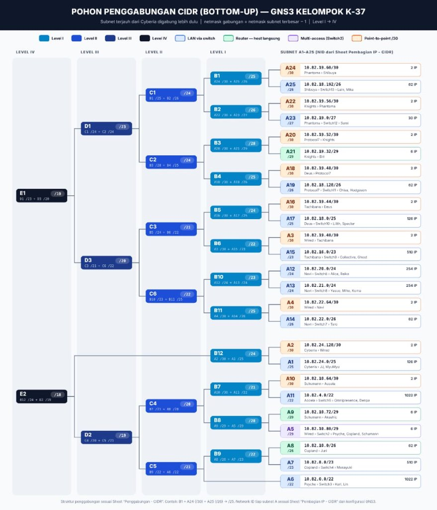

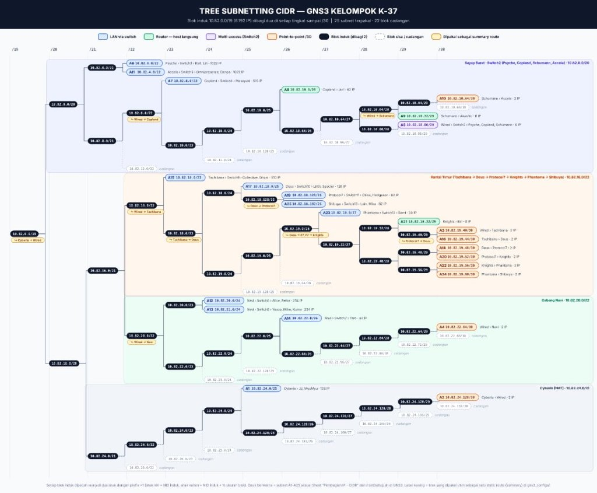

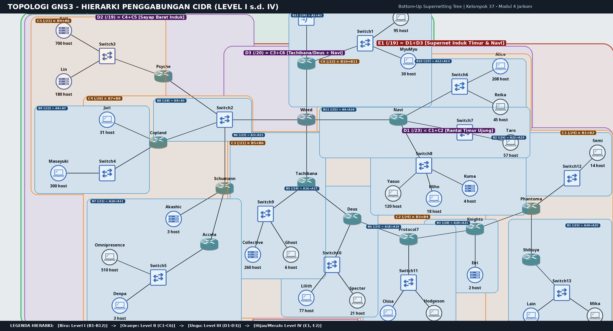

### 5.4 Pembagian IP CIDR & Alokasi Interface

Hasil pembagian IP (Sheet 4 spreadsheet) beserta alamat yang dipasang pada tiap interface di GNS3:

| Subnet | Network ID | Netmask | Broadcast | Alokasi di GNS3 |
|:---:|:---|:---|:---|:---|
| A1 | `10.82.24.0/25` | 255.255.255.128 | 10.82.24.127 | Cyberia eth1 `.1`, JJ `.2`, MyuMyu `.3` |
| A2 | `10.82.24.128/30` | 255.255.255.252 | 10.82.24.131 | Cyberia eth2 `.129`, Wired eth0 `.130` |
| A3 | `10.82.19.40/30` | 255.255.255.252 | 10.82.19.43 | Wired eth2 `.41`, Tachibana eth0 `.42` |
| A4 | `10.82.22.64/30` | 255.255.255.252 | 10.82.22.67 | Wired eth3 `.65`, Navi eth3 `.66` |
| A5 | `10.82.10.80/29` | 255.255.255.248 | 10.82.10.87 | Wired eth1 `.81`, Psyche eth0 `.82`, Copland eth0 `.83`, Schumann eth0 `.84` |
| A6 | `10.82.0.0/22` | 255.255.252.0 | 10.82.3.255 | Psyche eth1 `10.82.0.1`, Karl `.0.2`, Lin `.0.3` |
| A7 | `10.82.8.0/23` | 255.255.254.0 | 10.82.9.255 | Copland eth1 `10.82.8.1`, Masayuki `.8.2` |
| A8 | `10.82.10.0/26` | 255.255.255.192 | 10.82.10.63 | Copland eth2 `.1`, Juri `.2` |
| A9 | `10.82.10.72/29` | 255.255.255.248 | 10.82.10.79 | Schumann eth1 `.73`, Akashic `.74` |
| A10 | `10.82.10.64/30` | 255.255.255.252 | 10.82.10.67 | Schumann eth2 `.65`, Accela eth0 `.66` |
| A11 | `10.82.4.0/22` | 255.255.252.0 | 10.82.7.255 | Accela eth1 `10.82.4.1`, Omnipresence `.4.2`, Denpa `.4.3` |
| A12 | `10.82.20.0/24` | 255.255.255.0 | 10.82.20.255 | Navi eth0 `.1`, Alice `.2`, Reika `.3` |
| A13 | `10.82.21.0/24` | 255.255.255.0 | 10.82.21.255 | Navi eth1 `.1`, Yasuo `.2`, Miho `.3`, Kuma `.4` |
| A14 | `10.82.22.0/26` | 255.255.255.192 | 10.82.22.63 | Navi eth2 `.1`, Taro `.2` |
| A15 | `10.82.16.0/23` | 255.255.254.0 | 10.82.17.255 | Tachibana eth1 `10.82.16.1`, Collective `.16.2`, Ghost `.16.3` |
| A16 | `10.82.19.44/30` | 255.255.255.252 | 10.82.19.47 | Tachibana eth2 `.45`, Deus eth0 `.46` |
| A17 | `10.82.18.0/25` | 255.255.255.128 | 10.82.18.127 | Deus eth1 `.1`, Lilith `.2`, Specter `.3` |
| A18 | `10.82.19.48/30` | 255.255.255.252 | 10.82.19.51 | Deus eth2 `.49`, Protocol7 eth0 `.50` |
| A19 | `10.82.18.128/26` | 255.255.255.192 | 10.82.18.191 | Protocol7 eth1 `.129`, Chisa `.130`, Hodgeson `.131` |
| A20 | `10.82.19.52/30` | 255.255.255.252 | 10.82.19.55 | Protocol7 eth2 `.53`, Knights eth0 `.54` |
| A21 | `10.82.19.32/29` | 255.255.255.248 | 10.82.19.39 | Knights eth1 `.33`, Eiri `.34` |
| A22 | `10.82.19.56/30` | 255.255.255.252 | 10.82.19.59 | Knights eth2 `.57`, Phantoma eth0 `.58` |
| A23 | `10.82.19.0/27` | 255.255.255.224 | 10.82.19.31 | Phantoma eth1 `.1`, Semi `.2` |
| A24 | `10.82.19.60/30` | 255.255.255.252 | 10.82.19.63 | Phantoma eth2 `.61`, Shibuya eth0 `.62` |
| A25 | `10.82.18.192/26` | 255.255.255.192 | 10.82.18.255 | Shibuya eth1 `.193`, Lain `.194`, Mika `.195` |

Uplink Cyberia ke NAT1 memakai `192.168.122.50/24` dengan gateway `192.168.122.1` (jaringan bawaan node NAT GNS3).

Kesesuaian pengalamatan di GNS3 dengan Sheet 4 telah diverifikasi secara teliti: seluruh 25 subnet telah dialokasikan dengan tepat tanpa ada diskrepansi atau IP ganda.

### 5.5 Studi Kasus Perhitungan Manual Subnetting CIDR (Subnet A6)

Sebagai bentuk pertanggungjawaban konseptual perhitungan matematis pengalamatan CIDR, berikut adalah langkah kalkulasi manual penentuan prefix, ukuran blok (*block size*), Network ID, Broadcast, dan rentang usable IP untuk **Subnet A6 (Sayap Barat - Switch3)**:

#### 1. Menentukan Kebutuhan Host & Alokasi Prefix
* **Perangkat dalam Subnet**: Host Karl (700 host) + Host Lin (180 host) + 1 antarmuka gateway router Psyche (`eth1`).
* **Total Kebutuhan IP Riil**:
  $$\text{Total Kebutuhan} = 700 + 180 + 1 = 881\text{ host}$$
* **Rumus Kapasitas Subnet**:
  $$2^n - 2 \ge \text{Kebutuhan Host}$$
* **Pencarian Bit Host ($n$)**:
  * Untuk $n = 9 \implies 2^9 - 2 = 510$ host (tidak mencukupi untuk 881 host).
  * Untuk $n = 10 \implies 2^{10} - 2 = 1.022$ host (mencukupi).
  * Diperoleh alokasi bit host $n = 10$.
* **Penentuan Netmask CIDR**:
  $$\text{Prefix} = 32 - n = 32 - 10 = \mathbf{/22}$$
  Netmask desimal: `255.255.252.0`.

#### 2. Menghitung Ukuran Blok (Block Size) & Lompatan Oktet
* **Total Alokasi IP**:
  $$\text{Block Size} = 2^{32 - \text{Prefix}} = 2^{32 - 22} = 2^{10} = 1.024\text{ IP}$$
* **Lompatan Oktet ke-3**: Karena 1 oktet bernilai 256 alamat, maka:
  $$\frac{1.024}{256} = 4$$
  Artinya, alokasi blok Subnet A6 mencakup rentang 4 angka penuh pada oktet ketiga IP (misal: `10.82.0.0` s.d. `10.82.3.255`).

#### 3. Menentukan Network ID, Broadcast, dan Next Network
Berdasarkan hierarki pohon CIDR Kelompok 37, supernet Sayap Barat level II (`C5: 10.82.0.0/21`) menurunkan blok pertamanya secara berurutan ke Subnet A6:
* **Network ID (NID)**: `10.82.0.0`
* **Next Network**: Menambahkan nilai lompatan pada oktet ke-3:
  $$0 + 4 = 4 \implies \text{Next Network} = 10.82.4.0$$
* **Broadcast Address**: Tepat satu alamat sebelum *Next Network*:
  $$\text{Broadcast} = 10.82.3.255$$

#### 4. Menentukan Rentang Usable IP & Alokasi Perangkat
* **IP Pertama (Gateway Router Psyche `eth1`)**:
  $$\text{NID} + 1 \implies \mathbf{10.82.0.1}$$
* **IP Terakhir**:
  $$\text{Broadcast} - 1 \implies \mathbf{10.82.3.254}$$
* **Konfigurasi Interface & End-Device**:
  * Gateway Router Psyche (`eth1`): `10.82.0.1/22`
  * Server Karl (`eth0`): `10.82.0.2/22` (Gateway `10.82.0.1`)
  * Server Lin (`eth0`): `10.82.0.3/22` (Gateway `10.82.0.1`)

---

## 6. Topologi GNS3

Project GNS3: `K-37-MODUL-4` (Server Group B `10.4.89.247`). Berkas ekspor proyek portabel resmi tersedia pada tautan berikut: [`projects/Modul-4-K37.gns3project`](projects/Modul-4-K37.gns3project). Topologi terdiri dari 1 NAT, 13 router, 13 switch, dan 25 host.

### 6.1 Peta Topologi & Pembagian Wilayah Subnet

Berikut adalah peta topologi jaringan GNS3 yang dilengkapi dengan batas-batas wilayah *broadcast domain* untuk setiap subnet (A1 s.d. A25):

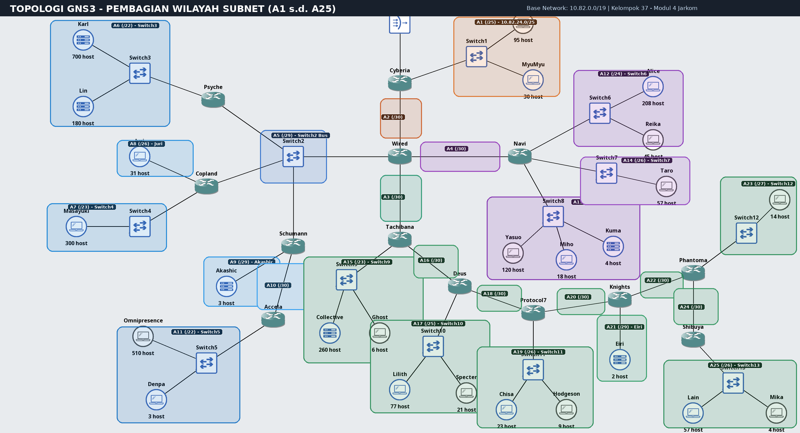

### 6.2 Tangkapan Layar Kanvas Proyek

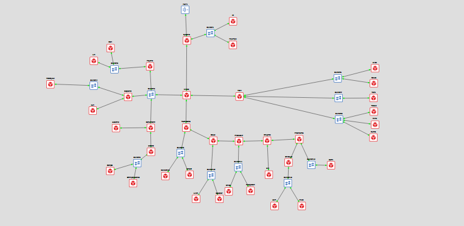

---

## 7. Konfigurasi Node GNS3 (/root/setup.sh)

Konfigurasi setiap node ditulis dalam satu file `/root/setup.sh` dan dijalankan dengan:

```sh
sh /root/setup.sh
```

Salinan seluruh script konfigurasi disimpan di dalam folder [`gns3_configs/`](gns3_configs/) (38 file, satu per node) yang disusun secara disiplin berdasarkan tabel alokasi Sheet 4 agar tidak terjadi pertukaran IP antar-node.

### 7.1 Strategi Routing

Routing memakai **static route** (tanpa OSPF/RIP), dengan prinsip:

1. **Stub router memakai default route saja**: Psyche, Copland, Accela, Navi, dan Shibuya hanya punya satu jalan keluar, jadi cukup `ip route add default via <next-hop>`.
2. **Transit router memakai summary CIDR**: Wired, Tachibana, Deus, Protocol7, dan Knights cukup menyimpan satu route untuk satu blok gabungan di arah bawah, bukan satu route per subnet.
3. Jika blok summary ikut mencakup link P2P yang sebenarnya berada di **atas** router tersebut, ditambahkan satu route yang lebih spesifik ke arah atas. Prinsip *longest prefix match* memastikan tidak terjadi loop.

| Router | Jumlah static route | Route |
|:---|:---:|:---|
| Cyberia | 2 | default → NAT1, `10.82.0.0/19` → Wired |
| Wired | 7 | default → Cyberia, `10.82.0.0/22` → Psyche, `10.82.4.0/22` & `10.82.10.64/28` → Schumann, `10.82.8.0/22` → Copland, `10.82.16.0/22` → Tachibana, `10.82.20.0/22` → Navi |
| Psyche, Copland, Accela, Navi, Shibuya | 1 | default saja |
| Schumann | 2 | default → Wired, `10.82.4.0/22` → Accela |
| Tachibana | 2 | default → Wired, `10.82.18.0/23` → Deus |
| Deus | 4 | default → Tachibana, `10.82.18.128/25` & `10.82.19.0/26` → Protocol7, `10.82.19.40/30` → Tachibana |
| Protocol7 | 4 | default → Deus, `10.82.18.192/26` & `10.82.19.0/26` → Knights, `10.82.19.40/29` → Deus |
| Knights | 4 | default → Protocol7, `10.82.18.192/26`, `10.82.19.0/27`, `10.82.19.60/30` → Phantoma |
| Phantoma | 2 | default → Knights, `10.82.18.192/26` → Shibuya |

### 7.2 Cyberia (NAT)

```sh
#!/bin/sh
sysctl -w net.ipv4.ip_forward=1

ip addr flush dev eth0
ip addr add 192.168.122.50/24 dev eth0
ip link set eth0 up

ip route add default via 192.168.122.1

ip addr flush dev eth1
ip addr add 10.82.24.1/25 dev eth1
ip link set eth1 up

ip addr flush dev eth2
ip addr add 10.82.24.129/30 dev eth2
ip link set eth2 up

ip route add 10.82.0.0/19 via 10.82.24.130

iptables -t nat -F POSTROUTING
iptables -t nat -A POSTROUTING -o eth0 -j MASQUERADE
echo 'nameserver 8.8.8.8' > /etc/resolv.conf
```

* `MASQUERADE` pada eth0 menerjemahkan seluruh alamat `10.82.x.x` menjadi IP Cyberia di jaringan NAT1.
* `10.82.0.0/19` cukup satu route untuk mengembalikan semua trafik ke Wired.

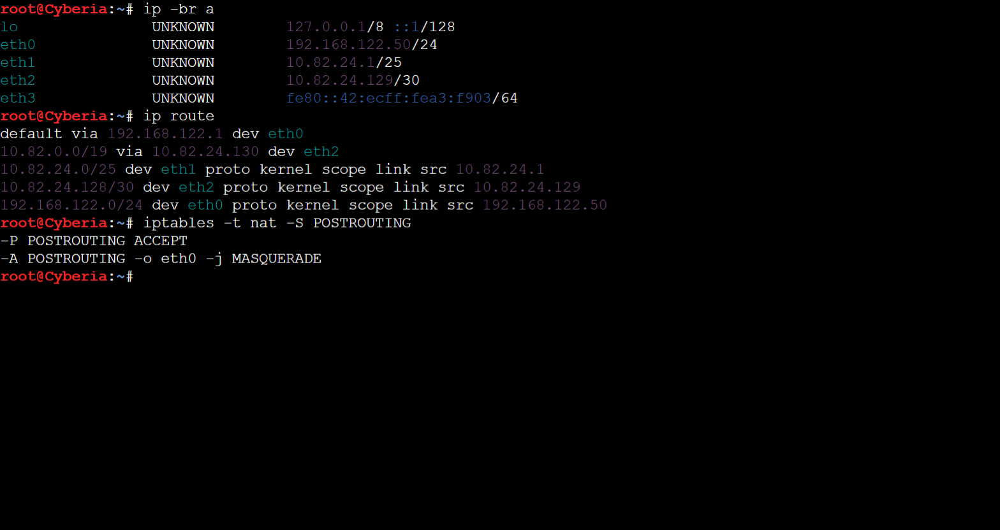

### 7.3 Wired (Core Hub)

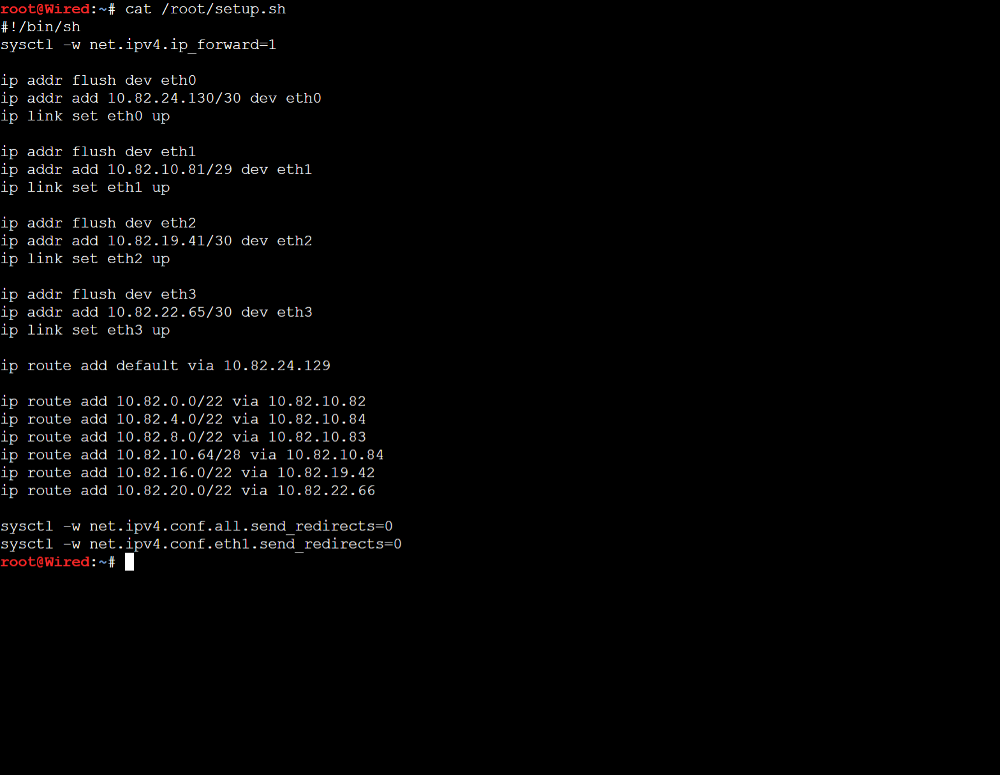

* Route sayap barat dipecah per router di Switch2. `10.82.8.0/22` (Copland) sekaligus mencakup Switch4 `10.82.8.0/23` dan Juri `10.82.10.0/26`. Blok `10.82.10.64/28` (A10 + A9 milik Schumann) lebih spesifik, jadi tetap diarahkan ke Schumann.
* Seluruh rantai timur (`10.82.16.0` – `10.82.19.255`) cukup `10.82.16.0/22` ke Tachibana.
* Seluruh cabang Navi (`10.82.20.0` – `10.82.23.255`) cukup `10.82.20.0/22` ke Navi.
* `send_redirects=0`: Psyche, Copland, dan Schumann berada dalam satu segmen (Switch2) dan default route-nya ke Wired. Paket di antara mereka diteruskan Wired kembali lewat eth1. ICMP redirect dimatikan agar hasil ping di segmen ini tidak tercampur pesan *Redirect Host*.

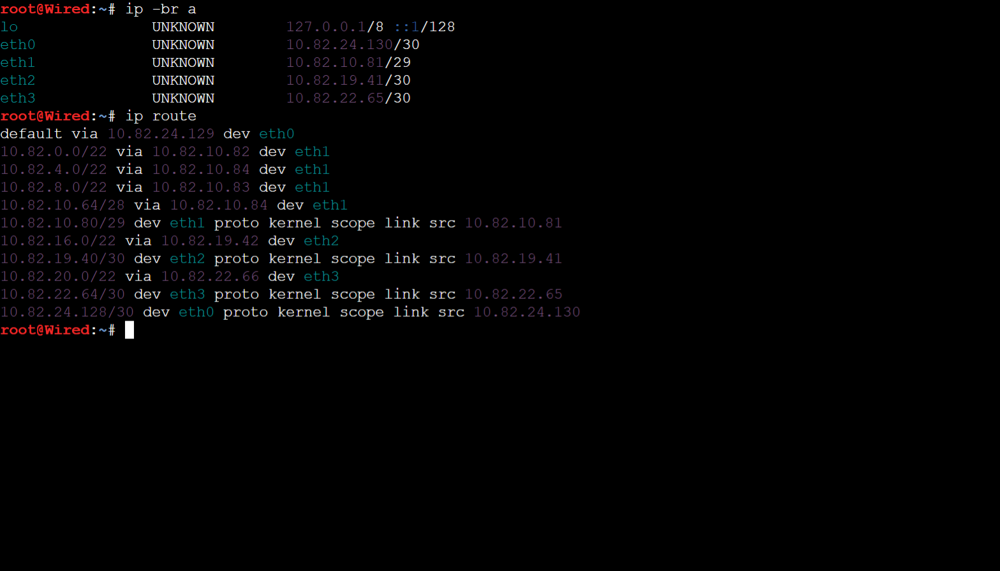

### 7.4 Router Sayap Barat & Navi

```sh
# Psyche
ip addr add 10.82.10.82/29 dev eth0
ip addr add 10.82.0.1/22 dev eth1
ip route add default via 10.82.10.81

# Copland
ip addr add 10.82.10.83/29 dev eth0
ip addr add 10.82.8.1/23 dev eth1
ip addr add 10.82.10.1/26 dev eth2
ip route add default via 10.82.10.81

# Schumann
ip addr add 10.82.10.84/29 dev eth0
ip addr add 10.82.10.73/29 dev eth1
ip addr add 10.82.10.65/30 dev eth2
ip route add default via 10.82.10.81
ip route add 10.82.4.0/22 via 10.82.10.66

# Accela
ip addr add 10.82.10.66/30 dev eth0
ip addr add 10.82.4.1/22 dev eth1
ip route add default via 10.82.10.65

# Navi
ip addr add 10.82.20.1/24 dev eth0
ip addr add 10.82.21.1/24 dev eth1
ip addr add 10.82.22.1/26 dev eth2
ip addr add 10.82.22.66/30 dev eth3
ip route add default via 10.82.22.65
```

(Setiap router juga menjalankan `sysctl -w net.ipv4.ip_forward=1`, serta `ip addr flush` dan `ip link set <iface> up` sebelum dan sesudah memasang alamat. Script lengkapnya ada di `gns3_configs/`.)

### 7.5 Rantai Timur (Tachibana s.d. Shibuya)

```sh
# Tachibana
ip route add default via 10.82.19.41
ip route add 10.82.18.0/23 via 10.82.19.46

# Deus
ip route add default via 10.82.19.45
ip route add 10.82.18.128/25 via 10.82.19.50
ip route add 10.82.19.0/26 via 10.82.19.50
ip route add 10.82.19.40/30 via 10.82.19.45

# Protocol7
ip route add default via 10.82.19.49
ip route add 10.82.18.192/26 via 10.82.19.54
ip route add 10.82.19.0/26 via 10.82.19.54
ip route add 10.82.19.40/29 via 10.82.19.49

# Knights
ip route add default via 10.82.19.53
ip route add 10.82.18.192/26 via 10.82.19.58
ip route add 10.82.19.0/27 via 10.82.19.58
ip route add 10.82.19.60/30 via 10.82.19.58

# Phantoma
ip route add default via 10.82.19.57
ip route add 10.82.18.192/26 via 10.82.19.62

# Shibuya
ip route add default via 10.82.19.61
```

Penjelasan route pada Deus:
* `10.82.18.128/25` = Switch11 (`18.128/26`) + Switch13 (`18.192/26`).
* `10.82.19.0/26` = Switch12, Eiri, dan link P2P Protocol7–Knights, Knights–Phantoma, serta Phantoma–Shibuya.
* Blok `/26` tersebut ikut mencakup `10.82.19.40/30` (link Wired–Tachibana) yang posisinya di atas Deus. Karena itu ditambahkan route `/30` yang lebih spesifik ke Tachibana. Tanpa route ini, paket ke `10.82.19.41` akan memantul bolak-balik antara Deus dan Protocol7.
* Protocol7 memakai pola yang sama dengan `10.82.19.40/29` (link Wired–Tachibana dan Tachibana–Deus).

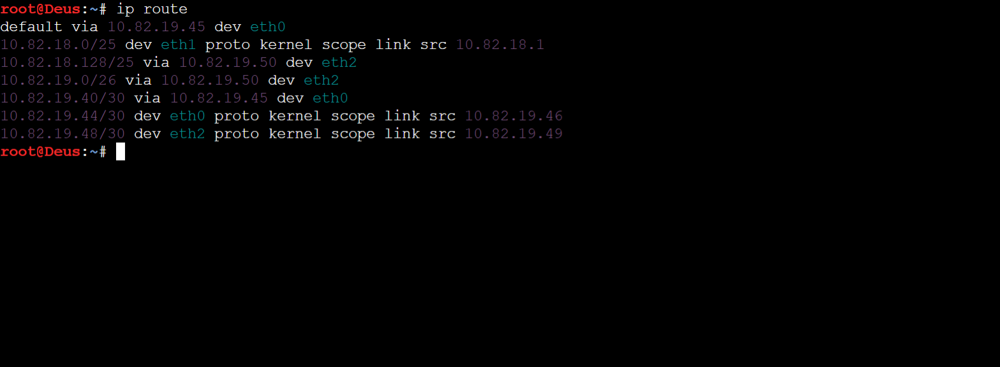
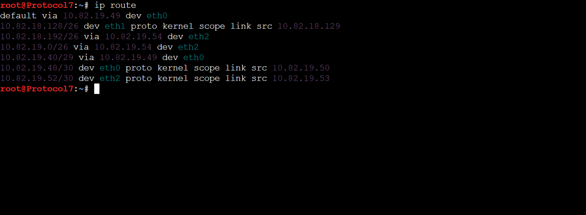

### 7.6 Konfigurasi Host

Semua host memakai pola yang sama, misalnya Karl:

```sh
#!/bin/sh
ip addr flush dev eth0
ip addr add 10.82.0.2/22 dev eth0
ip link set eth0 up

ip route add default via 10.82.0.1
echo 'nameserver 8.8.8.8' > /etc/resolv.conf
```

---

## 8. Uji Konektivitas GNS3

| No | Uji | Hasil |
|:---:|:---|:---:|
| 1 | Intra-LAN: JJ → MyuMyu | 0% loss |
| 2 | Lintas Switch2: Karl → Masayuki | 0% loss |
| 3 | Dalam segmen Switch2: Psyche → Accela & Juri | 0% loss |
| 4 | Ujung ke ujung: Lain → Karl (9 hop) | 0% loss |
| 5 | Ujung ke ujung: Mika → Miho (cabang Navi) | 0% loss |
| 6 | Internet via NAT: JJ & Lain → 8.8.8.8 | 0% loss |
| 7 | Full-mesh: setiap node ping ke 37 node lain | **1406/1406 berhasil** |

**Intra-LAN (JJ → MyuMyu)**
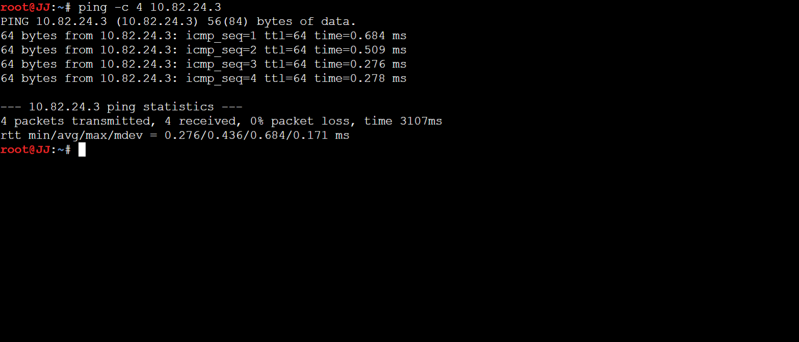

**Lintas Switch2 (Karl → Masayuki)**
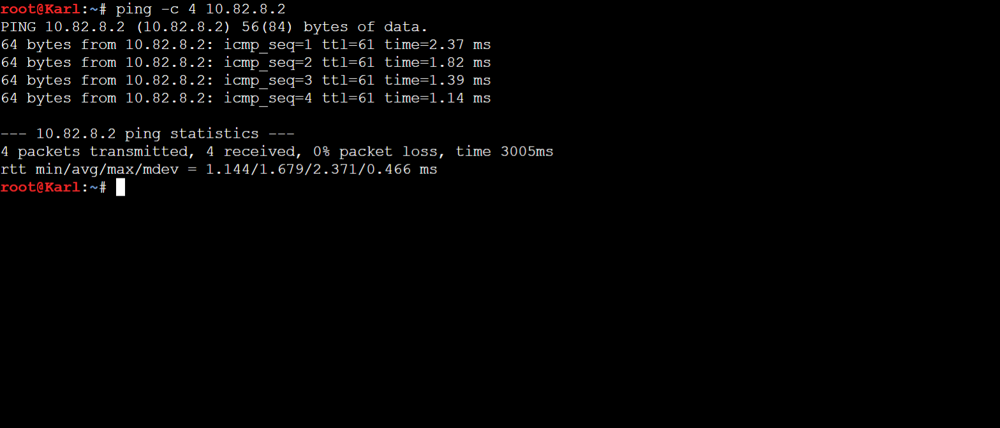

**Dalam segmen Switch2 (Psyche → Accela `10.82.10.66` & Juri `10.82.10.2`)**
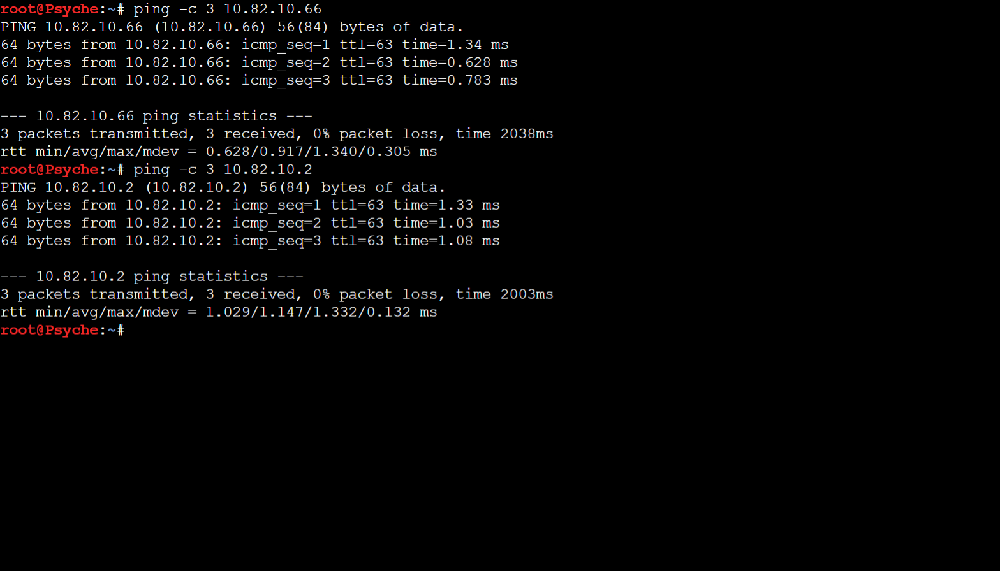

**Ujung ke ujung (Lain → Karl) + traceroute**: jalurnya Shibuya → Phantoma → Knights → Protocol7 → Deus → Tachibana → Wired → Psyche → Karl.
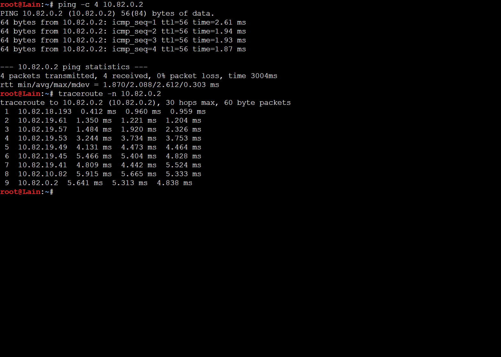

**Ujung ke ujung ke cabang Navi (Mika → Miho)**
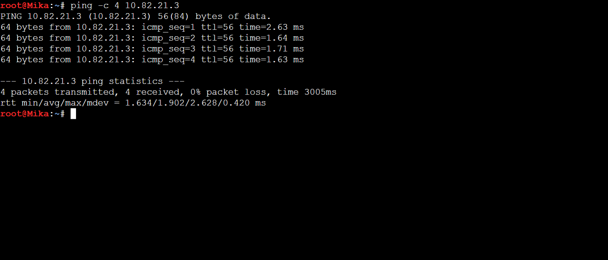

**Internet lewat NAT Cyberia**
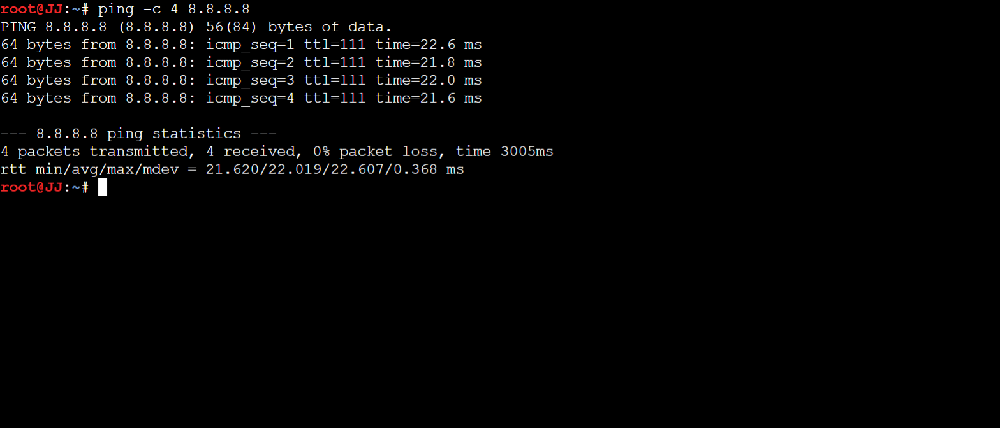
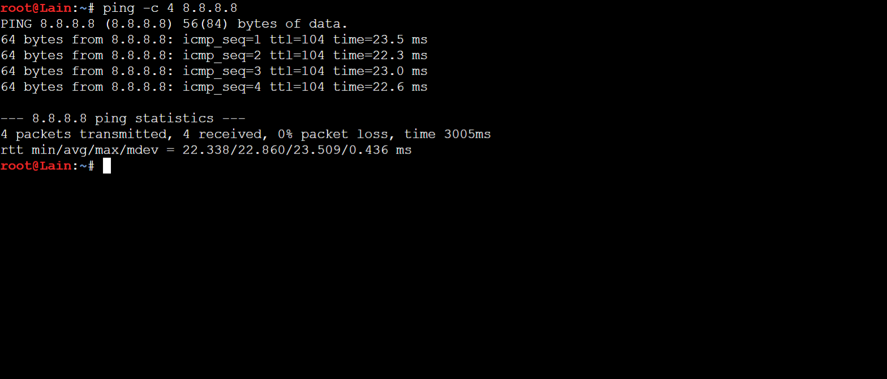

**Full-mesh dari Lain (node terdalam) ke semua node lain**
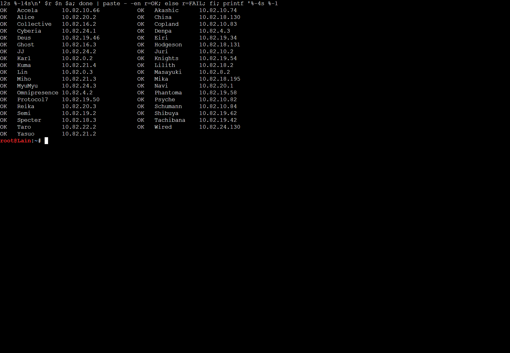

Seluruh pengujian konektivitas pada ke-38 node dilakukan secara bertahap mulai dari subnet lokal hingga pengujian menyeluruh antar-node di seluruh topologi.

---

## 9. Kendala & Penyelesaian

1. **Subnet A5, A9, A10 sempat tertukar.** Konfigurasi awal memakai `10.82.10.72/29` untuk Switch2, `10.82.10.64/29` untuk Akashic, dan `10.82.10.80/30` untuk Schumann–Accela. Alokasi ini tidak sesuai Sheet 4, lalu diperbaiki menjadi A5 `10.82.10.80/29`, A9 `10.82.10.72/29`, dan A10 `10.82.10.64/30`, beserta penyesuaian next-hop di Wired, Psyche, Copland, Schumann, dan Accela.
2. **Summary `10.82.19.0/24` di Deus dan Protocol7 menimbulkan loop.** Blok tersebut ikut mencakup link `10.82.19.40/30` dan `10.82.19.44/30` yang berada di arah atas. Solusinya: summary diperkecil menjadi `/26`, ditambah satu route spesifik ke arah atas (lihat 7.5).
3. **Link Wired eth3 – Navi eth3 tidak meneruskan paket.** IP dan route sudah benar, tetapi counter TX/RX menunjukkan trafik tidak lewat, dan server GNS3 melaporkan *Adapter 3 is not connected*. Link dibuat ulang di adapter dan port yang sama (Wired 3/0 – Navi 3/0) saat kedua node dalam kondisi stop. Setelah node dinyalakan lagi dan `setup.sh` dijalankan ulang, link normal kembali.
4. **Ping antar router di Switch2 menampilkan "Redirect Host".** Ini perilaku normal Linux router pada segmen multi-access. Pesan tersebut dihilangkan dengan `send_redirects=0` di Wired (lihat 7.3).
